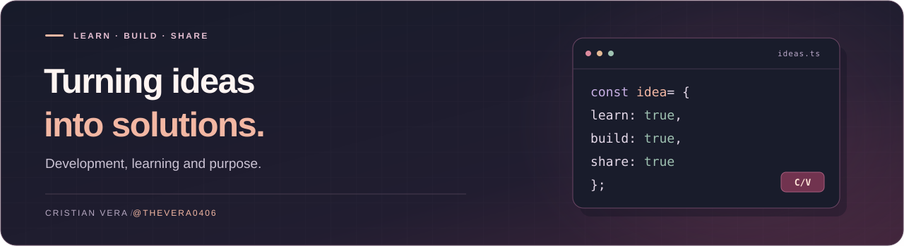

  
  &nbsp;
  

  

<h1 align="center">Hi, I'm Cristian Vera 👋</h1>

  <strong>Computer Science Engineering student · Universidad Austral de Chile</strong> 
  Web development · Android apps · Data and artificial intelligence

  
  &nbsp;
  
  &nbsp;
  

## A little about me

I'm **Cristian Alejandro Vera Ulloa**, a computing student at UACh in Chile. I enjoy turning real needs into useful software and understanding how each part works: the interface, the logic and the data.

I've contributed to collaborative web development projects and worked on information management solutions, mobile apps, and academic projects in artificial intelligence and compilers. I learn by building, reviewing my work and sharing ideas with others.

- **My focus:** web development, software architecture and data visualization.
- **What motivates me:** creating tools that simplify tasks and make information easier to access.
- **What I'm exploring:** AI information retrieval, programming languages and SaaS products.
- **I also enjoy:** sharing knowledge and making technology easier to understand.

## Technologies I work with

Tools I use and continue learning through projects and university coursework.

### Languages

### Web development

### Android

### Data and artificial intelligence

### Environment and tools

## Experience and development areas

### Web development and data visualization

I've contributed to collaborative web applications for managing information and making it easier to analyze. My experience covers user interfaces, backend services, relational databases and visualization through dashboards, charts and reports.

### Mobile applications

I work on Android applications that simplify everyday tasks, with interactive interfaces, local storage and media handling. I'm interested in clear experiences that let users stay in control of their data.

### Artificial intelligence and information retrieval

I've explored AI document question answering, from content processing and context retrieval to answer generation. I've worked with vector and hybrid retrieval, including variants with multiple queries and reranking.

### Collaboration and technology education

I've developed solutions in academic, personal and internship settings, collaborating with others and documenting the work. I've also prepared educational resources to explain computing concepts in a visual, approachable way.

## How I like to work

- Understand the problem and requirements before designing a solution.
- Keep responsibilities separate and code clear.
- Collaborate through Git, document decisions and improve through review.
- Use AI tools to support learning and development, checking their results.

---

  <strong>I'm interested in collaborating, learning and building solutions that help other people.</strong>

  <a href="https://www.linkedin.com/in/CristianVera-IngenieriaInformatica">LinkedIn</a> ·
  <a href="mailto:cristianvera0406@gmail.com">cristianvera0406@gmail.com</a> ·
  <a href="https://github.com/TheVera0406">@TheVera0406</a>

