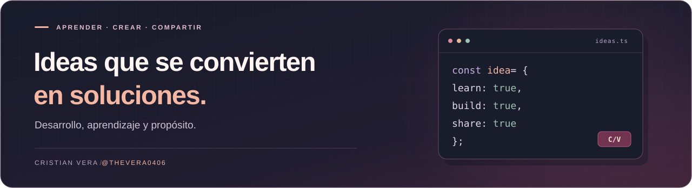

  
  &nbsp;
  

  

<h1 align="center">Hola, soy Cristian Vera 👋</h1>

  <strong>Estudiante de Ingeniería Civil en Informática · Universidad Austral de Chile</strong> 
  Desarrollo web · Aplicaciones Android · Datos e inteligencia artificial

  
  &nbsp;
  
  &nbsp;
  

## Un poco sobre mí

Soy **Cristian Alejandro Vera Ulloa**, estudiante de informática en la UACh, Chile. Me gusta convertir necesidades concretas en software útil y entender cómo funciona cada parte: la interfaz, la lógica y los datos.

He participado en proyectos colaborativos de desarrollo web y he trabajado en soluciones para la gestión de información, aplicaciones móviles y proyectos académicos. Aprendo construyendo, revisando lo que hago y compartiendo ideas con otras personas, me desenvuelvo muy bien en entornos de equipo, ya que disfruto conociendo gente nueva y trabajando de forma colaborativa.

- **Mi foco:** desarrollo web, arquitectura de software y visualización de datos.
- **Lo que me motiva:** crear herramientas que simplifiquen tareas y faciliten el acceso a la información.
- **Lo que exploro:** recuperación de información con IA, lenguajes de programación y productos SaaS.
- **También disfruto:** compartir conocimientos y explicar tecnología de forma cercana.

## Tecnologías con las que trabajo

Herramientas que utilizo y sigo aprendiendo a través de mis proyectos y mi formación universitaria.

### Lenguajes

### Desarrollo web

### Android

### Datos e inteligencia artificial

### Entorno y herramientas

## Experiencia y áreas de desarrollo

### Desarrollo web y visualización de datos

He participado en el desarrollo colaborativo de aplicaciones web para gestionar información y facilitar su análisis. Mi experiencia abarca interfaces, servicios backend, bases de datos relacionales y visualización mediante dashboards, gráficos y reportes.

### Aplicaciones móviles

Trabajo en aplicaciones Android orientadas a simplificar tareas cotidianas, con interfaces interactivas, almacenamiento local y manejo de contenido multimedia. Me interesa crear experiencias claras que permitan al usuario mantener el control sobre sus datos.

### Inteligencia artificial y recuperación de información

He explorado sistemas de consulta de documentos con IA, desde el procesamiento del contenido y la búsqueda de contexto hasta la generación de respuestas. He trabajado con recuperación vectorial e híbrida y variantes con múltiples consultas y reordenamiento de resultados.

### Colaboración y divulgación tecnológica

He desarrollado soluciones en contextos académicos, personales y de práctica, colaborando con otras personas y documentando el trabajo. También he preparado recursos educativos para explicar conceptos de informática de forma visual y cercana.

## Cómo me gusta trabajar

- Entender el problema y los requisitos antes de diseñar la solución.
- Separar responsabilidades y mantener el código claro.
- Colaborar con Git, documentar decisiones y mejorar a partir de la revisión.
- Usar herramientas de IA para apoyar el aprendizaje y el desarrollo, comprobando sus resultados.

---

  <strong>Me interesa colaborar, aprender y construir soluciones que sean útiles para otras personas.</strong>

  <a href="https://www.linkedin.com/in/CristianVera-IngenieriaInformatica">LinkedIn</a> ·
  <a href="mailto:cristianvera0406@gmail.com">cristianvera0406@gmail.com</a> ·
  <a href="https://github.com/TheVera0406">@TheVera0406</a>

